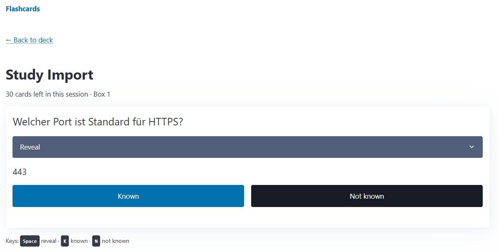

# Flashcards

A flashcard trainer based on the Leitner system, built as a small web app.

Cards live in five boxes. A card you know moves up one box and comes back later; a card you do not know returns to box 1 and is due again right away.

| Box | Due again after |
| --- | --------------- |
| 1   | same day        |
| 2   | 1 day           |
| 3   | 3 days          |
| 4   | 7 days          |
| 5   | 14 days         |

## Features

- Decks and cards: create, rename, edit and delete, inline without page reloads (HTMX)
- Study mode: each due card comes up once per session, lowest box first
- Keyboard control in study mode: `Space` reveals, `K` rates as known, `N` as not known
- Statistics per deck: cards per box, total and due today
- CSV import (`front;back`, one card per line) with duplicate detection and per-line error reports
- JSON API under `/api` with interactive docs at `/docs`
- Runs offline: HTMX and Pico.css are bundled, no CDN

## Screenshot



## Requirements

- Python 3.12 or newer

## Installation

```sh
git clone https://github.com/mrasdev/flashcards.git
cd flashcards
python -m venv .venv
```

Activate the virtual environment:

```sh
# Windows (PowerShell)
.venv\Scripts\Activate.ps1

# macOS / Linux
source .venv/bin/activate
```

Install the package with its development dependencies:

```sh
pip install -e ".[dev]"
```

## Running the app

```sh
uvicorn flashcards.main:app --reload
```

Then open <http://127.0.0.1:8000>.

Data is stored in a SQLite file, `flashcards.db` in the current directory by default. Set the environment variable `FLASHCARDS_DB` to use a different path.

To try the app with sample data, create a deck and import `demo/it-fragen.csv`. It contains IT questions in German.

## Tests

```sh
ruff check .
pytest
```

Behavior that only shows up in a browser is covered by the checklist in [docs/MANUAL_TESTS.md](docs/MANUAL_TESTS.md).

## Project structure

```
src/flashcards/
  main.py            # app, routers, static files
  db.py              # engine and session
  models.py          # Deck, Card
  schemas.py         # input/output models of the API
  leitner.py         # Leitner rules as pure functions
  services.py        # database logic shared by API and HTML
  csv_import.py      # CSV parser and import
  deps.py            # FastAPI dependencies (session, today, now)
  routers/api.py     # JSON under /api
  routers/pages.py   # HTML pages and HTMX partials
  templates/         # Jinja2 templates
  static/            # htmx.min.js, pico.min.css, app.css, study.js
tests/               # pytest suite
docs/                # plan, decisions and manual test checklist
demo/                # sample CSV
```

## AI-assisted development

This project is a deliberate exercise in AI-assisted software development.
Code was written in collaboration with Claude (Anthropic); commits carry
a Co-Authored-By trailer. I defined requirements, reviewed every change,
directed code reviews and made the design decisions documented in docs/.

## License

Released under the MIT License. See [LICENSE](LICENSE).
